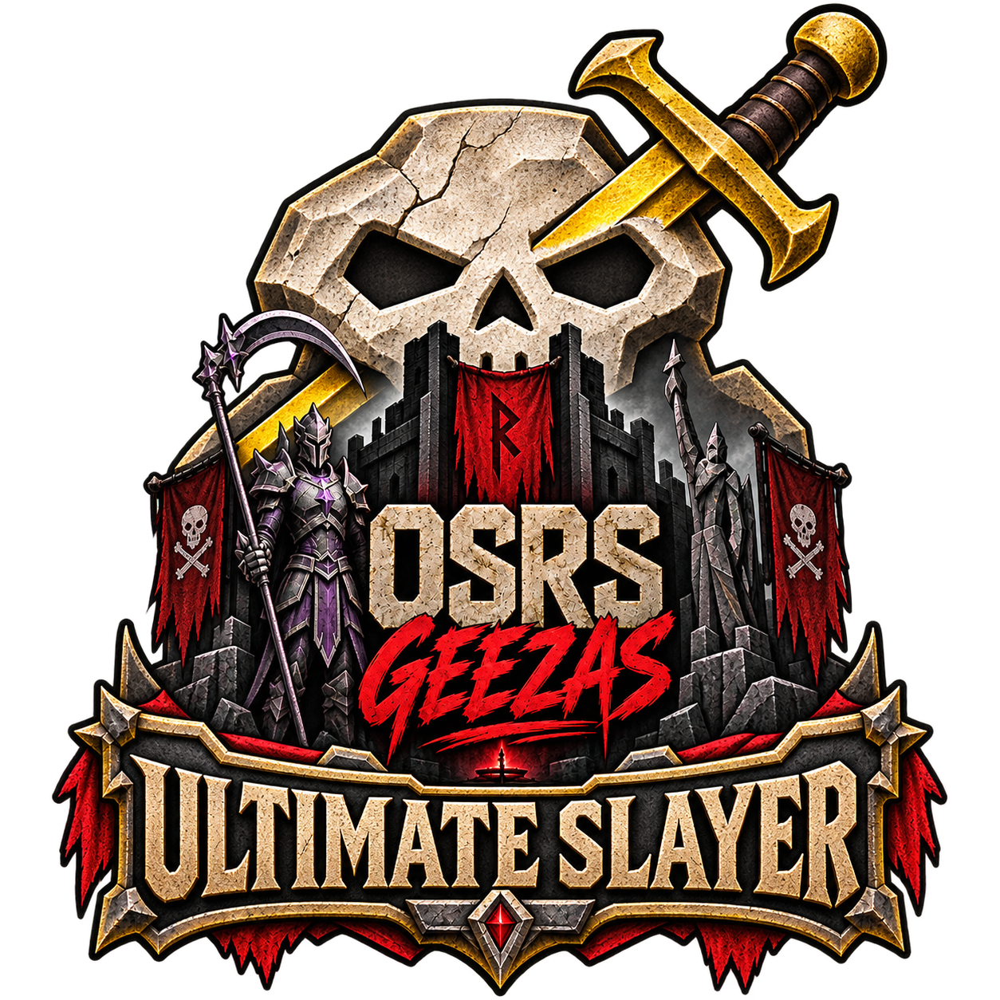

# Ultimate Slayer

Plan Slayer tasks and compare equipment you own from a RuneLite sidebar. Created by **Th3keeza0** for **OSRS geezers**.

## Features

- View Slayer task and monster variant information.
- Capture a local, character-specific equipment snapshot when you open your personal bank.
- Compare owned melee, ranged and magic setups for supported normal attacks.
- Review equipment requirements, spell plans and combat assumptions before choosing a setup.
- Enable the modules you want in plugin settings.

The plugin provides information and planning only. It never equips items, moves your character or performs game actions.

## Use it

1. Open your personal bank once. Close/reopen for a new ownership snapshot; withdrawals, tabs and searches do not recapture.
2. In the sidebar choose the actual **monster variant**. Task previews stay separate from your real assignment and assigned-area restrictions.
3. Choose a **Wiki strategy** method. The owned view lists up to three owned choices per slot and highlights them in your personal bank: **1 green, 2 yellow, 3 red**. Main and special-attack weapons are separate. Review conditional notes using the source-page link. See [WIKI_GEAR.md](WIKI_GEAR.md).
4. Check the combat assumptions and press **Find best modeled setup**. Select **Show in draft**, then expand **Why this setup / limits** for the applied effects, rolls and exclusions.
5. CHECK items still need requirement/state confirmation. Never treat a planning result as proof you can access the area or complete the whole task safely.

The original bonus shortlist remains available whenever a numerical model is unavailable. Search is bounded: six ordinary candidates per armour slot plus effect pieces, all observed ammunition candidates, 24 starting loadouts, three improvement passes and at most 40,000 evaluations. **Best found modeled setup** is not a proof of global optimality.

## Scope and privacy

The offline catalog retains 2,921 monster/variant records, 5,096 equipment records, 152 task/alias groups, 2,135 advisory item skill entries and 61 spell names/books. Catalog coverage is broader than combat-model coverage. Supported rune planning covers twenty standard elemental spells.

The combat model deliberately withholds numerical recommendations for unmodeled target mechanics and weapons/passives such as Fang, Scythe, Twisted bow, Shadow, blowpipe and enchanted-bolt procs. Normal attacks exclude special attacks, poison/burn, AoE, regeneration, overkill and downtime. See COMBAT_MODEL.md and COVERAGE.md for boundaries. Master assignment probabilities, drop/profit tables and Tile Packs integration are not currently included.

Optional public Wiki table updates send only monster/task page titles to the OSRS Wiki; tables are cached for seven days, and Araxxor has a bundled offline baseline. Disable updates to use cached/bundled data only. No bank uploads, telemetry, credentials, PIN/login-widget access or game input. Snapshots remain local and character-specific. The bank is enumerated once per legitimate opening; comparisons use immutable capture-time ownership. Bank ranks paint already-visible personal-bank widgets without scanning containers. Current carried/worn views remain separate. Clear suppresses current-opening recapture. The shared bounded IO queue preserves deletion ordering across controller changes; process-crash deletion durability is not guaranteed.

## Clan

Want to join OSRS geezers? Add **Th3keeza0** in game or [join our Discord](https://discord.gg/UAAe6QEGD). The plugin opens this only when you click the button.

## Sources and development

Data licences and attribution are documented in [THIRD_PARTY.md](THIRD_PARTY.md) and [SOURCES.md](SOURCES.md). See [CONTRIBUTING.md](CONTRIBUTING.md) for development setup and [VALIDATION.md](VALIDATION.md) for validation coverage.

